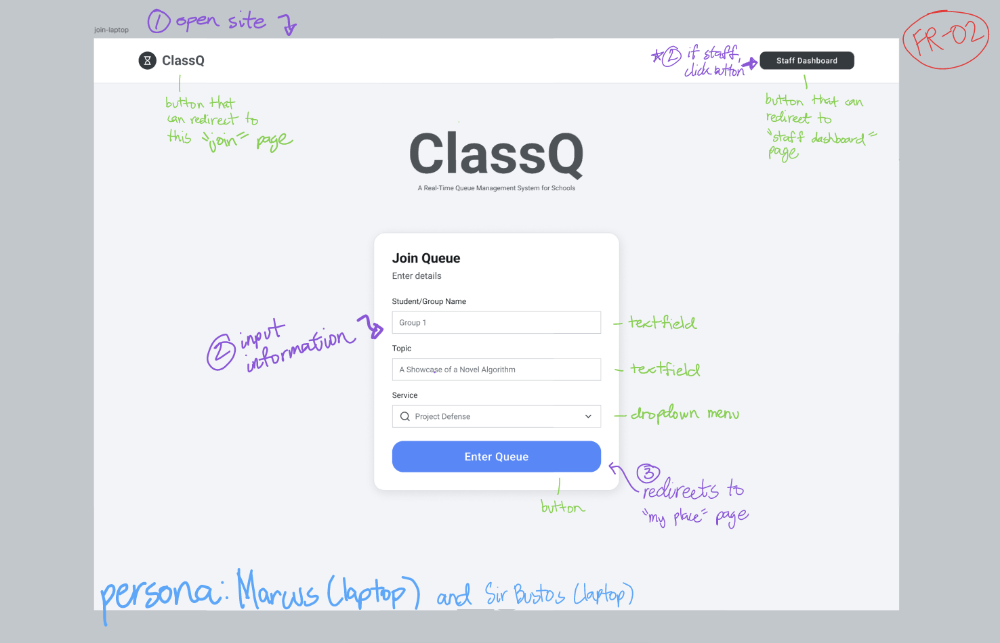
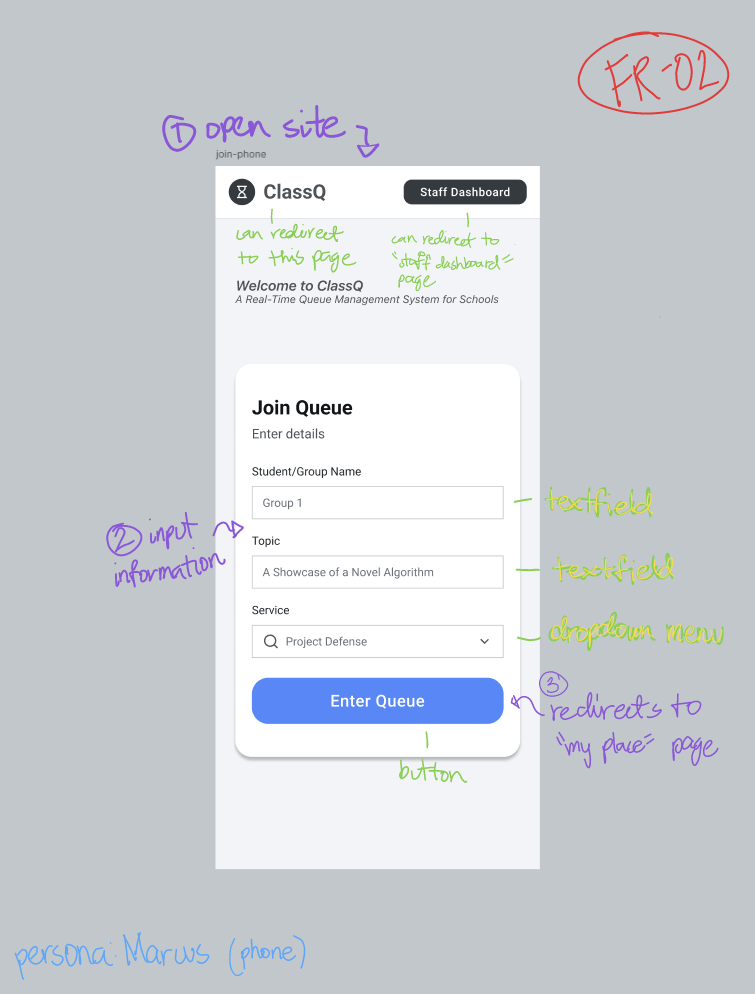
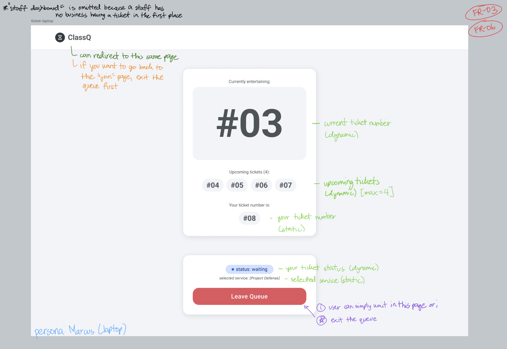
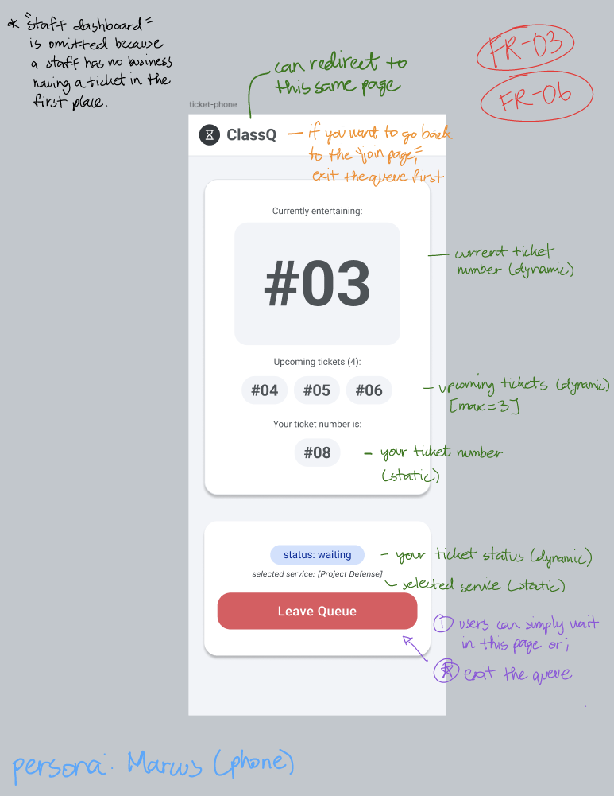
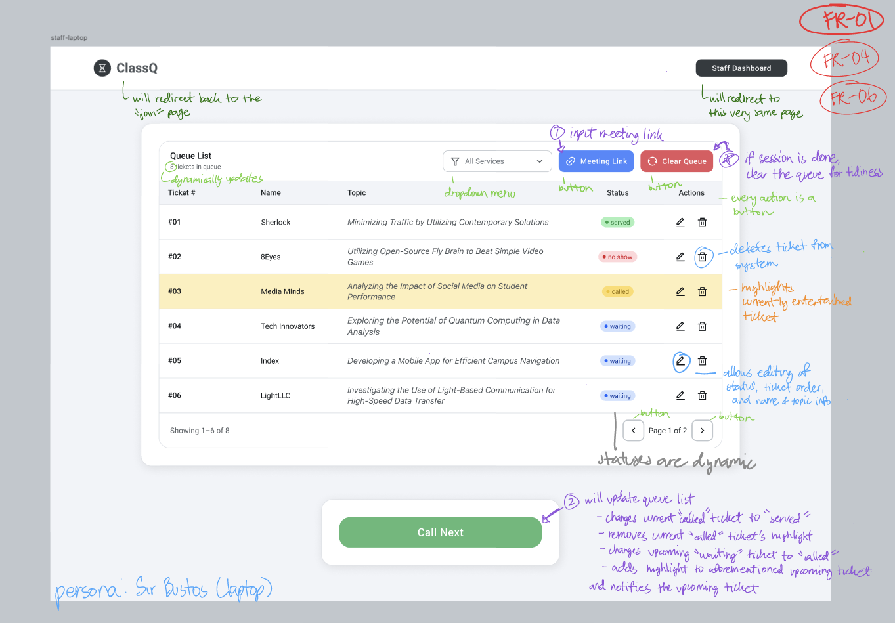
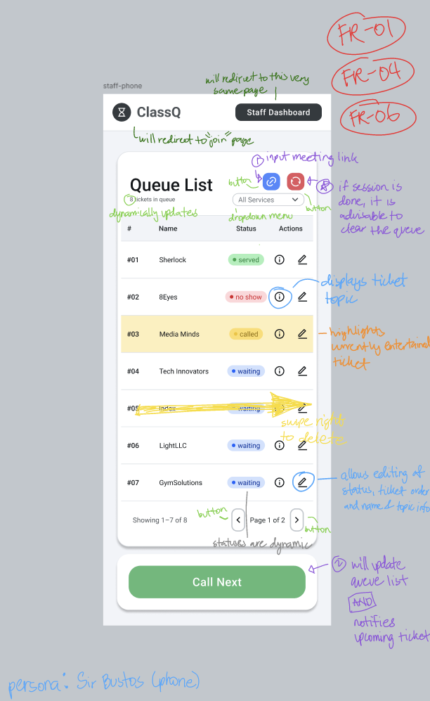
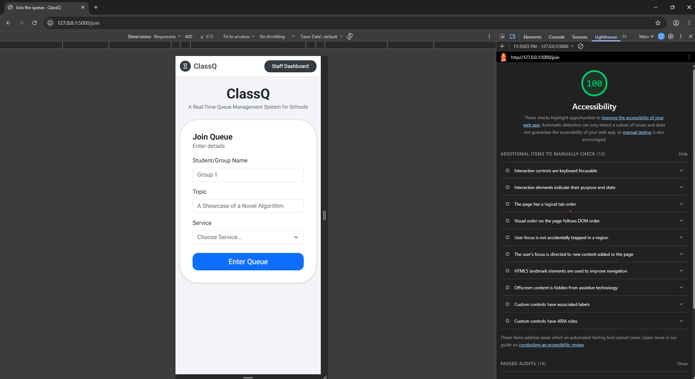
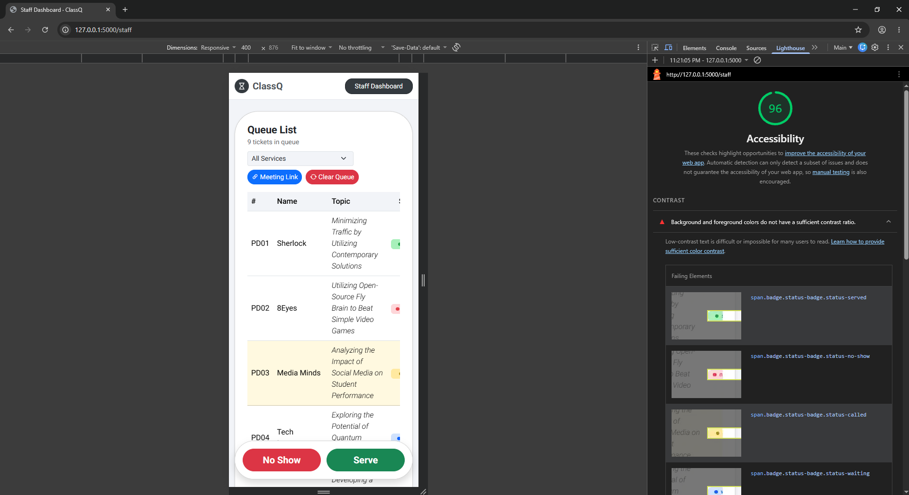
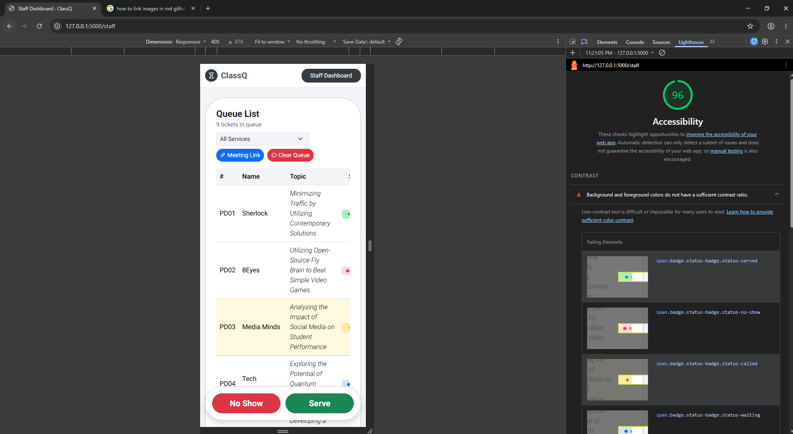

# ClassQ: Week 3 Design, Usability & Accessibility Report

## 1. Title details
- **App name:** ClassQ
- **Setting:** Academic defenses and 1-on-1 consultations in university and secondary school courses
- **Full name:** Gian Christian S. Bonilla
- **Student ID:** 2024-0408 (or your actual ID)
- **Section:** CS3A
- **Date submitted:** October 28, 2026
- **Pull Request link:** [\[GitHub Pull Request Link Here\]](https://github.com/gianbonilla-IIT/BONILLA-CCC181/compare/feature/week3-interface?expand=1)

---

## 2. Personas
- **Marcus (The Waiting Student):** 3rd-year Computer Science student managing heavy project-based coursework. 
  - *Quote:* "I spent valuable time periodically checking the queueing documents so that I'll know when I am up. I get anxious when the updates stop..."
  - *Top tasks:* Join the defense queue rapidly without account friction; monitor live position and status in real time; leave the queue if needed.
- **Sir Bustos (The Teacher / Staff Member):** Teacher handling laboratory classes with 30+ students per section.
  - *Quote:* "Managing 1-on-1 calls as a teacher demands a lot of patience with current solutions."
  - *Top tasks:* View active queue ordered by arrival time; advance line with one click; mark groups as served or no-show.
- *Full details available in [personas.md](personas.md).*

---

## 3. Screens

| Screen | Laptop View | Phone View | Persona & Requirements |
| :--- | :--- | :--- | :--- |
| **Join Queue** |  |  | Used by **Marcus** to submit group details; covers **FR-02**. |
| **My Place** |  |  | Used by **Marcus** to track live standing and ticket status; covers **FR-03, FR-06**. |
| **Staff Dashboard** |  |  | Used by **Sir Bustos** to manage the queue and call turns; covers **FR-01, FR-04, FR-06**. |

---

## 4. Design decisions
1. **Prominent Giant Active Counter (`display-1`):** I placed the currently active ticket counter in extra-large text at the top of the ticket screen because student interviews revealed high anxiety over whether document updates had stalled while they reviewed slides.
2. **Fixed 44px Touch Targets on Staff Action Buttons:** I enforced a strict minimum height and width of 44x44 pixels with centered icons on all table action buttons, tied directly to Sir Bustos's persona constraint of avoiding accidental misclicks during fast-paced back-to-back defense runs.
3. **Zero Registration Friction Join Form:** I designed the join form to require only a group name, topic, and service track without passwords or account creation, adhering to Marcus's rule that students must join rapidly before defense slots fill up.

---

## 5. Self-review
- **Main problems found:** In the initial wireframes, destructive actions (such as clearing the entire queue or deleting individual tickets) were positioned too close to routine controls with single-click triggers, risking catastrophic data loss during live sessions. Additionally, unvalidated dropdown states could cause accidental mis-categorizations.
- **What was changed:** Wrapped all destructive actions in browser `confirm()` dialogue checks, added explicit `aria-label` attributes for screen readers, and implemented a disabled instructional default option (`Choose Service...`) on the join form.

---

## 6. Accessibility
- **Lighthouse Scores:**
  - Join screen: **100/100** 
  - Queue screen: **96/100** 
  - Staff screen: **96/100** 
- **Most important issue fixed:** During keyboard-only navigation testing, I noticed that the primary "Call Next" button on the staff dashboard lacked a clear visual focus ring when reached via the `Tab` key, making it look unresponsive. I added a custom CSS focus-shadow and border styling so keyboard users always know exactly where their focus lies.

---

## 7. Usability test
- **Task 1 ("Get in line for Project Defense"):** Completed successfully in ~22 seconds. The tester appreciated the client-side submit-disabling that prevented accidental double-submits.
- **Task 2 ("How many people are ahead of you?"):** Completed successfully in ~8 seconds. The tester noted that the giant currently-entertaining counter initially drew their eye away from their own smaller ticket number badge, but the position text below clarified it instantly.
- **Task 3 ("Call the next person and mark served"):** Completed successfully in ~35 seconds. The tester successfully cleared the called ticket and advanced the queue.
- **One improvement made (Before & After):** 
  - *Before:* Clicking "Call Next" on a filtered staff dashboard reset the view back to "All Services" because the `service_id` parameter was lost.
  - *After:* Added a hidden `service_id` input to the call-next form and updated `app.py` to route back through `_back_to_dashboard()`, preserving the teacher's active filter.

---

## 8. Reflection
- **Hardest part this week:** Balancing clean responsive card alignment across both ultra-wide desktop monitors and 375 px mobile viewports without causing horizontal page scrolling.
- **What to change when moving to a database in Week 4:** Replace in-memory list filtering and global integer counters with proper database primary keys and persistent rows, ensuring ticket URLs remain permanently unique even if preceding tickets are deleted or reordered.

---

## 9. Declaration
- AI tools used: Gemini (used as an interactive coding collaborator to help structure Jinja2 templates, debug CSS flex alignment, and verify Python route logic).