# ClassQ: Week 4 report

## 1. Title details

| | |
| --- | --- |
| **App** | ClassQ |
| **Setting** | Academic defenses and 1-on-1 instructor consultations in schools |
| **Name** | Gian Christian S. Bonilla |
| **Student ID** | 2024-0408 |
| **Section** | CS3A |
| **GitHub username** | gianbonilla-IIT |
| **Date** | 2026-11-09 |
| **Pull request** | [\[GitHub Pull Request Link Here\]](https://github.com/gianbonilla-IIT/BONILLA-CCC181/pull/4)|
| **Database** | PostgreSQL 17 in Docker Compose (I did not use the local PostgreSQL fallback) |

---

## 2. Requirements

Full list: [`docs/requirements.md`](../requirements.md).

- **Functional requirements:** 10 (FR-01 to FR-10), of which 3 are marked ★ for my setting. Two of them, FR-07 (estimated waiting time) and FR-08 (CSV export), are dropped this semester, so 8 are in scope.
- **Non-functional requirements:** 6 (NFR-01 to NFR-06), covering performance, usability, privacy, accessibility, reliability and data integrity.
- **MVP:** FR-01 (queue room with a meeting link), FR-02 (join with name, topic and service, no account), FR-03 (live view of my place), FR-04 (Call Next), FR-05 (live status updates), FR-06 (leave the queue, or mark served or no-show), FR-09 (manage services) and FR-10 (delete mistaken tickets).
- **What a person from my setting said:** I showed the list to Al, a CSM student. He said the **Topic** field was unclear: he did not know whether to write his full paper title or a short summary of his problem, and that this depends on the service. He also said that joining quickly without creating an account, seeing his exact place in line, and getting the meeting link the moment his group is called matter most.
- **What I changed:** I clarified the topic requirement in FR-02 and the placeholder text on the join form.

---

## 3. ERD

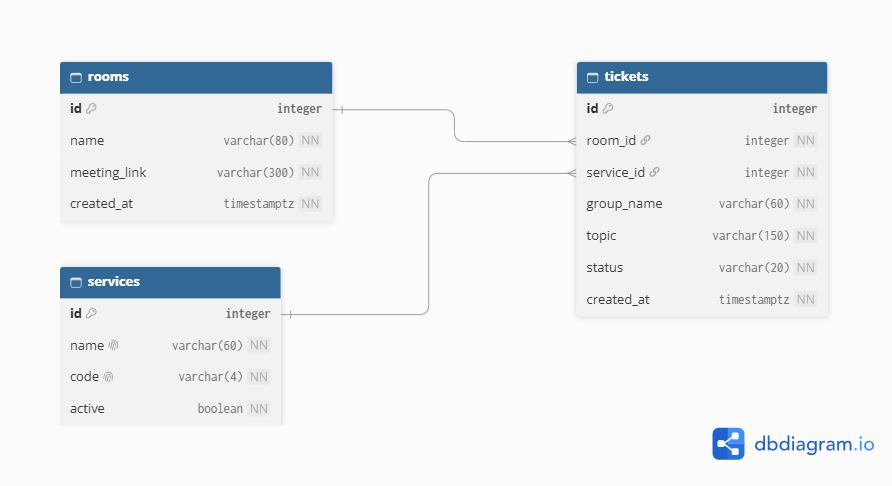

Relationships, read aloud:

- **One room has many tickets**, and each ticket belongs to exactly one room (`tickets.room_id`).
- **One service has many tickets**, and each ticket belongs to exactly one service (`tickets.service_id`).

There is no many-to-many relationship, so there is no join table. Every foreign key uses `ON DELETE RESTRICT`: a room or service that still has tickets cannot be deleted. Full design, with the reason for every column: [`docs/week4/schema.md`](schema.md).

---

## 4. Schema

Output of `\d` for each table:

```text
                                     Table "public.rooms"
    Column    |           Type           | Collation | Nullable |           Default            
--------------+--------------------------+-----------+----------+------------------------------
 id           | integer                  |           | not null | generated always as identity
 name         | character varying(80)    |           | not null | 
 meeting_link | character varying(300)   |           | not null | 
 created_at   | timestamp with time zone |           | not null | now()
Indexes:
    "rooms_pkey" PRIMARY KEY, btree (id)
Check constraints:
    "ck_rooms_meeting_link" CHECK (meeting_link::text ~ '^https?://'::text)
Referenced by:
    TABLE "tickets" CONSTRAINT "tickets_room_id_fkey" FOREIGN KEY (room_id) REFERENCES rooms(id) ON DELETE RESTRICT
```

```text
                               Table "public.services"
 Column |         Type          | Collation | Nullable |           Default            
--------+-----------------------+-----------+----------+------------------------------
 id     | integer               |           | not null | generated always as identity
 name   | character varying(60) |           | not null | 
 code   | character varying(4)  |           | not null | 
 active | boolean               |           | not null | true
Indexes:
    "services_pkey" PRIMARY KEY, btree (id)
    "services_code_key" UNIQUE CONSTRAINT, btree (code)
    "services_name_key" UNIQUE CONSTRAINT, btree (name)
Check constraints:
    "ck_services_code" CHECK (code::text ~ '^[A-Z]{2,4}$'::text)
Referenced by:
    TABLE "tickets" CONSTRAINT "tickets_service_id_fkey" FOREIGN KEY (service_id) REFERENCES services(id) ON DELETE RESTRICT
```

```text
                                   Table "public.tickets"
   Column   |           Type           | Collation | Nullable |           Default            
------------+--------------------------+-----------+----------+------------------------------
 id         | integer                  |           | not null | generated always as identity
 room_id    | integer                  |           | not null | 
 service_id | integer                  |           | not null | 
 group_name | character varying(60)    |           | not null | 
 topic      | character varying(150)   |           | not null | 
 status     | character varying(20)    |           | not null | 'waiting'::character varying
 created_at | timestamp with time zone |           | not null | now()
Indexes:
    "tickets_pkey" PRIMARY KEY, btree (id)
    "ux_tickets_active_group_name" UNIQUE, btree (room_id, lower(group_name::text)) WHERE status::text = ANY (ARRAY['waiting'::character varying, 'called'::character varying]::text[])
    "ux_tickets_one_called_per_room" UNIQUE, btree (room_id) WHERE status::text = 'called'::text
Check constraints:
    "ck_tickets_group_name" CHECK (length(TRIM(BOTH FROM group_name)) > 0)
    "ck_tickets_status" CHECK (status::text = ANY (ARRAY['waiting'::character varying, 'called'::character varying, 'served'::character varying, 'no-show'::character varying, 'left'::character varying]::text[]))
    "ck_tickets_topic" CHECK (length(TRIM(BOTH FROM topic)) > 0)
Foreign-key constraints:
    "tickets_room_id_fkey" FOREIGN KEY (room_id) REFERENCES rooms(id) ON DELETE RESTRICT
    "tickets_service_id_fkey" FOREIGN KEY (service_id) REFERENCES services(id) ON DELETE RESTRICT
```

---

## 5. Design decisions

1. **There is no `users` table, and a ticket stores its own group name and topic.** My personas never log in (Marcus just opens a link, NFR-02), and my organizational needs ask for as little personal data as possible. A group's name and defense topic also change from one defense to the next, so they describe one visit and belong on `tickets`. Hence, it deviated from the instructions a bit.
2. **I do not store a position in line.** Marcus's biggest frustration is a status that goes stale, so ClassQ counts how many tickets are still waiting ahead of his, in the database, every time the page is built (FR-03). A stored "position" would be wrong as soon as someone ahead leaves. Order comes from `created_at` and the ticket `id`, which breaks ties.
3. **The database enforces the two queue rules that staff depend on, not just Flask.** Sir Bustos needs one called group at a time, and Marcus can double-tap on a slow connection. A partial unique index allows one *called* ticket per room (`ux_tickets_one_called_per_room`), and another allows one *active* ticket per group name in a room (`ux_tickets_active_group_name`). A finished or left ticket frees the name, so a group can rejoin. Flask turns the database error into a friendly message.

---

## 6. Self-review

Full review: [`docs/week4/schema-review.md`](schema-review.md).

| Problem found | What I changed |
| --- | --- |
| `services.code` (the PD, LC, GR label prefix) had no requirement behind it | Added a requirement for ticket labels and traced the column to it |
| My first draft stored `avg_minutes`, `called_at` and `finished_at` only for the waiting-time estimate, which I dropped | Removed the three columns, so nothing is stored that no feature reads |
| Removing the email also removed protection against joining twice | Added the partial unique index on active group names per room |
| Delete rules protect parents, but the app can still delete tickets | Kept `RESTRICT` on all foreign keys, and kept Delete and Clear Queue behind a confirmation |

---

## 7. Migrations

| File in `migrations/versions/` | What it does |
| --- | --- |
| `196d07260edc_initial_tables.py` | Creates `rooms`, `services` and `tickets` with their keys, CHECK and UNIQUE constraints, foreign keys, and the partial index on active group names |
| `b4ff024814a6_one_called_ticket_per_room.py` | Adds the partial unique index `ux_tickets_one_called_per_room`, so only one ticket per room can be *called* at a time |

Both scripts were reviewed before I applied them, and I ran `downgrade` then `upgrade` to check that the second change can be undone and redone.

---

## 8. CRUD

| Operation | Route | Requirement | Screenshot |
| --- | --- | --- | --- |
| **Create**: join the queue | `POST /join` | FR-02 | 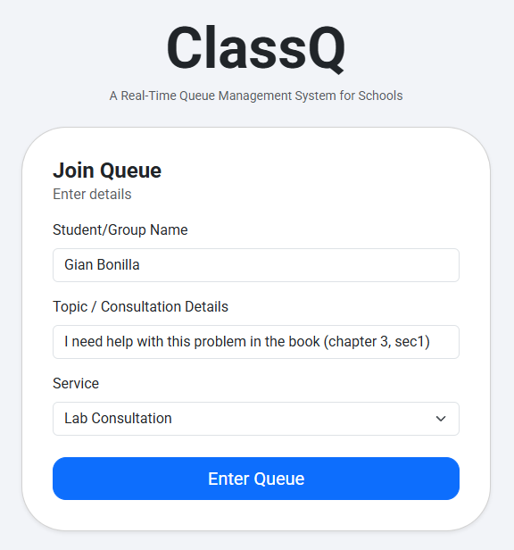 |
| **Read**: My place and the staff dashboard | `GET /queue/<id>` and `GET /staff` | FR-03, FR-05 | 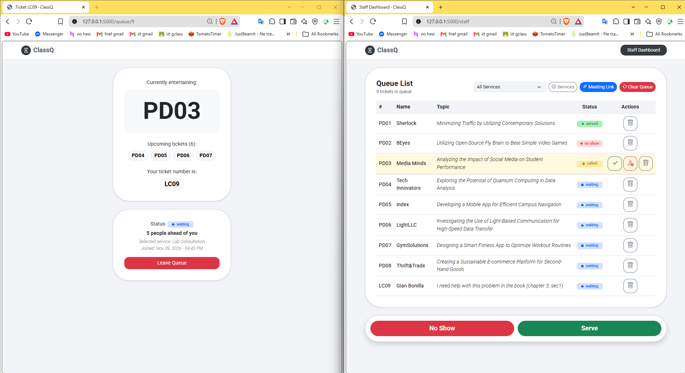 |
| **Update**: call, serve and no-show | `POST /staff/tickets/<id>/<action>` and `POST /staff/call-next` | FR-04, FR-06 | 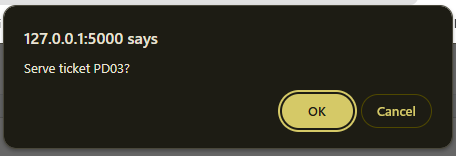 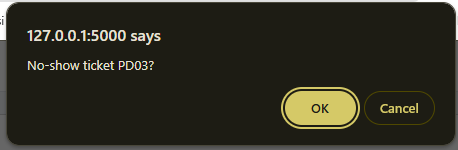 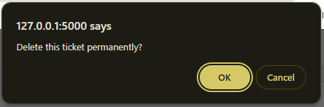|
| **Soft delete**: leave the queue (status becomes `left`, the row stays) | `POST /queue/<id>/leave` | FR-06 | 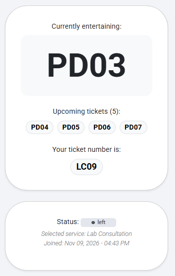 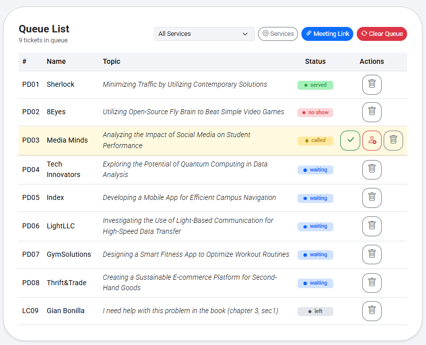 |
| **Hard delete**: remove a mistaken ticket | `POST /staff/tickets/<id>/delete` | FR-10 | 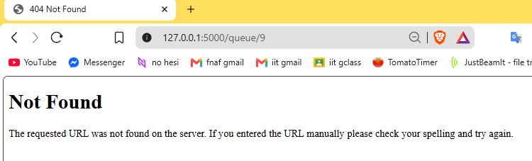 |

I also built **Manage services** (create, rename, switch off and delete, refused when a service has tickets) at `/staff/services` for FR-09, and a way to save the meeting link (`POST /staff/meeting-link`) for FR-01. Every route that changes data is a POST.

---

## 9. Validation

Full evidence: [`docs/week4/validation.md`](validation.md). I tested each rule in the layer that should catch it, by skipping the layer above:

| Layer | Rules tested | How |
| --- | --- | --- |
| Browser | 3 | `required` and `maxlength` attributes that match the column rules |
| Flask | 9, plus an injection check | `curl` requests that skip the form: blank or too long fields, a missing or switched-off service, a duplicate group, and staff actions that are not allowed. Each returned 400 (or a redirect with a warning) and saved nothing |
| Database | 15 | Bad `INSERT`, `UPDATE` and `DELETE` statements in psql, with at least one for FOREIGN KEY, NOT NULL, CHECK, UNIQUE and `ON DELETE RESTRICT` |

The `git grep` check for SQL built in f-strings printed nothing.

**The PostgreSQL error I found most useful:**

```text
ERROR:  duplicate key value violates unique constraint "ux_tickets_active_group_name"
```

It showed that the database itself stops a double tap, even though the form's disabled button only works in the browser. The `DETAIL` line told me exactly which room and group name were already in line, which made the friendly "That group is already in the queue." message easy to write.

---

## 10. Persistence

Full document: [`docs/week4/persistence.md`](persistence.md).

**Restart test.** I created tickets in more than one service, called one, served one and let one group leave. Then I stopped Flask, ran `docker compose down`, started it again with `docker compose up -d`, and restarted Flask.

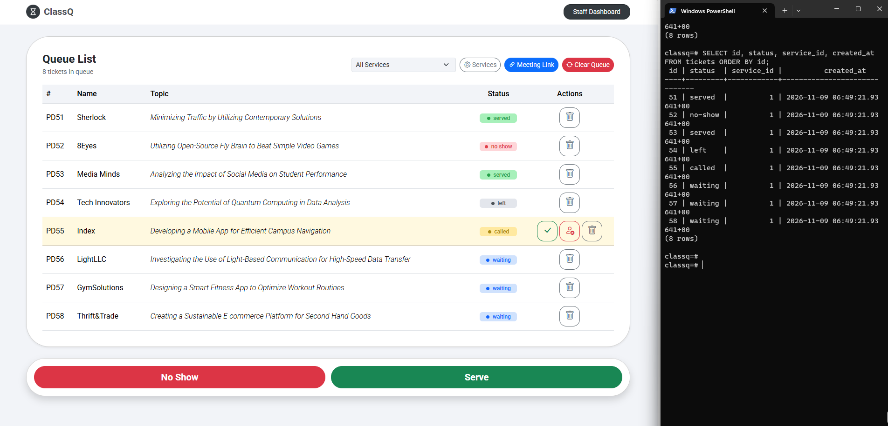
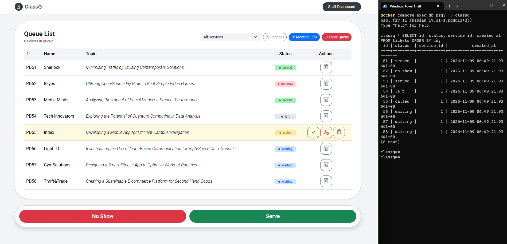

The dashboard after the restart shows the same tickets, statuses and times as before.

**Rebuild from scratch.** I ran `docker compose down -v`, then `docker compose up -d`, `flask --app app db upgrade` and `flask --app app seed`. The app opened, the join form listed my services, and I could join the queue, so my migrations and seed command rebuild the whole database.

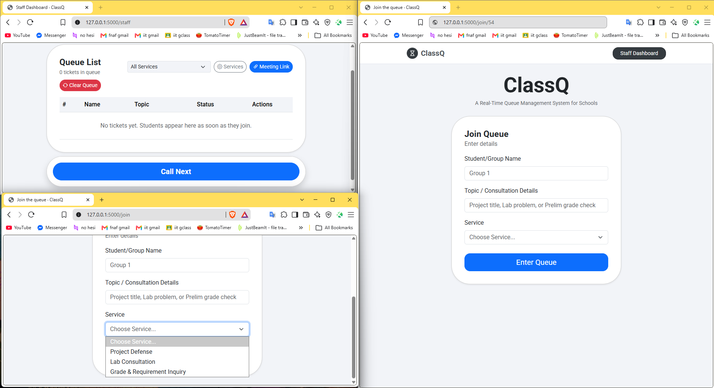
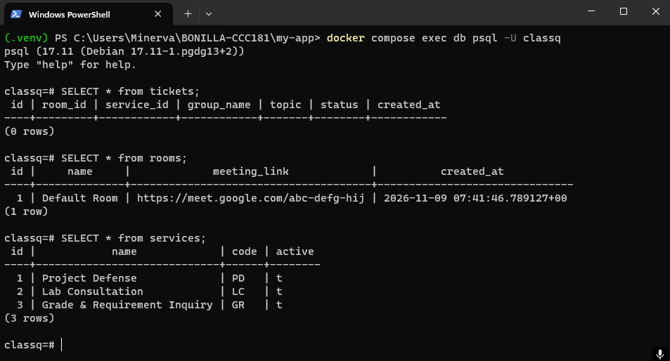

**Result:** NFR-01 and NFR-05 (no ticket or queue state is lost when Flask or PostgreSQL restarts) **passed**.

---

## 11. Reflection

Ultimately, it comes down to how a person plans the work to be done. Hence, hw4's parts 1-3 were the most difficult, as it basically made the foundation for the workflow ahead. It took some time to finalize decisions, so that the workflow will be smooth.

Moreover, researching existing ticketing systems was a great boon to my knowledge. For example, I had concerns of the existing non-ending auto-increment counter for the tickets.id. Online resources say that this is the best approach, so I will make do with this approach. My thought is one could just rebuild the database if there is a need to reset the database counter to 1, but I think it is unlikely that will happen since it will take a long time to reach higher integer values that would make reading tickets for customers a problem.

---

## 12. Declaration

I used **Claude (Anthropic)** as an assistant for this activity. It helped me draft some parts of my documentation, write and test code for the Flask routes, models, migrations and templates, and assist with the validation tests. I reviewed and tested the work, and I can explain every table, constraint and route in my submission. No other outside sources were used apart from the course materials and the PostgreSQL, SQLAlchemy and Flask documentation.