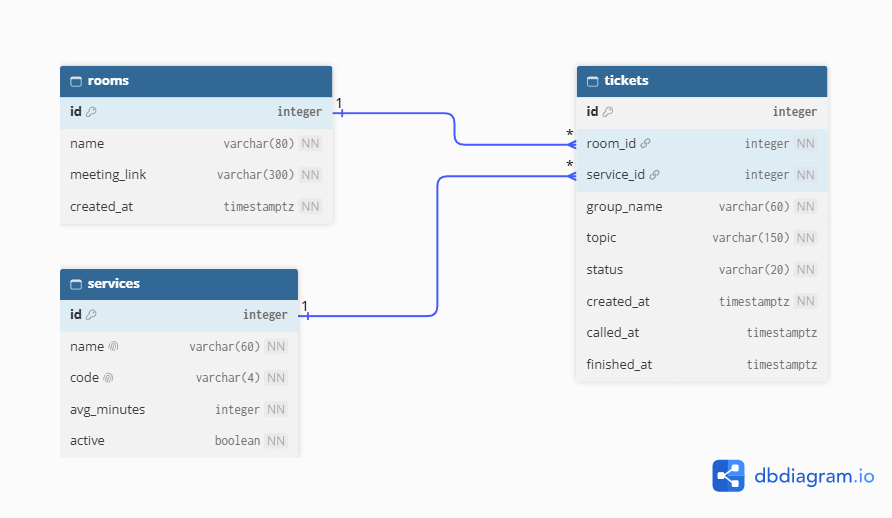

# ClassQ schema design (Week 4)

Designed from the requirements marked **Stores data? = Yes** in [`docs/requirements.md`](../requirements.md).

---

## 2a. Nouns in the requirements

| Req ID | Requirement | Nouns | Table or column? |
| --- | --- | --- | --- |
| FR-01 | A **teacher** can create a queue **room** with an active **meeting link**. | teacher, room, meeting link | `rooms`, `rooms.meeting_link` |
| FR-02 | A **student** can join the queue with their **name**, project **topic** and **service** option, without an account. | student, name, topic, service | `tickets.group_name`, `tickets.topic`, `services` |
| FR-03 | A student can see their **status** and **position** in line on a live dashboard. | status, position | `tickets.status`, *(computed)* |
| FR-04 | A teacher can **call the next** group. | called time | `tickets.status`, `tickets.called_at` |
| FR-05 | A student sees real-time **status** updates on their **ticket**. | ticket, status | `tickets`, `tickets.status` |
| FR-06 | A student can **leave** the queue, or a teacher can mark a ticket **served** or **no-show**. | status, finished time | `tickets.status` (adds `left`), `tickets.finished_at` |
| FR-07 | An **estimated countdown** based on **average call duration**. | average duration | `services.avg_minutes`, *(computed from `called_at` and `finished_at`)* |
| FR-08 | *(Dropped this semester.)* Export of queue **history** and **attendance**. | history, attendance | *(no new data: `tickets` already keeps every status and time)* |
| FR-09 | A teacher can manage **services**: add, rename, set **average duration**, toggle **active**. | service, name, average duration, active | `services`, `services.name`, `services.avg_minutes`, `services.active` |
| FR-10 | A teacher can permanently **delete** a mistaken ticket. | ticket | *(a hard delete of one `tickets` row; no new column)* |

---

## 2b. Tables and columns

| Table | Columns |
| --- | --- |
| `rooms` | id, name, meeting_link, created_at |
| `services` | id, name, code, avg_minutes, active |
| `tickets` | id, room_id, service_id, group_name, topic, status, created_at, called_at, finished_at |

**Where the setting-specific fields went**:

- **Topic and group name** → `tickets`
- **Service code (PD, LC, GR)** → `services` (used to build ticket labels such as `PD08`).
- **Meeting link** → `rooms` (one link for the whole queue session).
- **Active / switched off** → `services`

---

## 2c. Types and constraints

| Table | Column | PostgreSQL type | Constraint | Why |
| --- | --- | --- | --- | --- |
| rooms | id | integer, generated always as identity | PRIMARY KEY | Generated by the database, never reused (NFR-06) |
| rooms | name | varchar(80) | NOT NULL | A teacher needs to tell rooms apart, e.g. "CS3A Capstone Defense" |
| rooms | meeting_link | varchar(300) | NOT NULL, CHECK (meeting_link ~ '^https?://') | Students must always have a link they can open (FR-01) |
| rooms | created_at | timestamptz | NOT NULL DEFAULT now() | Time zone safe; set by the database |
| services | id | integer, generated always as identity | PRIMARY KEY | Generated by the database |
| services | name | varchar(60) | NOT NULL UNIQUE | No two services with the same name (FR-09) |
| services | code | varchar(4) | NOT NULL UNIQUE, CHECK (code ~ '^[A-Z]{2,4}$') | Short prefix for ticket labels; capital letters only |
| services | avg_minutes | integer | NOT NULL DEFAULT 15, CHECK (avg_minutes > 0) | Rejects impossible call lengths (FR-07, FR-09) |
| services | active | boolean | NOT NULL DEFAULT true | A service can be switched off without deleting its history (FR-09) |
| tickets | id | integer, generated always as identity | PRIMARY KEY | The ticket number: the database hands out every number once, so no duplicates (NFR-06) |
| tickets | room_id | integer | NOT NULL, FOREIGN KEY → rooms(id) ON DELETE RESTRICT | A ticket always belongs to a room |
| tickets | service_id | integer | NOT NULL, FOREIGN KEY → services(id) ON DELETE RESTRICT | No ticket for a service that does not exist |
| tickets | group_name | varchar(60) | NOT NULL, CHECK (length(trim(group_name)) > 0) | Matches the 60-character limit in the join form; blank names rejected |
| tickets | topic | varchar(150) | NOT NULL, CHECK (length(trim(topic)) > 0) | Matches the 150-character limit in the join form (FR-02) |
| tickets | status | varchar(20) | NOT NULL DEFAULT 'waiting', CHECK (status IN ('waiting', 'called', 'served', 'no-show', 'left')) | Only the five states the app uses (FR-03, FR-04, FR-06) |
| tickets | created_at | timestamptz | NOT NULL DEFAULT now() | When the group joined: the order of the line |
| tickets | called_at | timestamptz | NULL | Empty until the ticket is called (FR-04) |
| tickets | finished_at | timestamptz | NULL, CHECK (finished_at >= called_at) | Empty until served or no-show; with `called_at` it gives call length (FR-07). A NULL passes the check. |

---

## 2d. Relationships and ERD

| Relationship | Kind | Foreign key |
| --- | --- | --- |
| rooms → tickets | 1 : N | `tickets.room_id` |
| services → tickets | 1 : N | `tickets.service_id` |

*One room has many tickets.   
One service has many tickets.   
Each ticket belongs to exactly one room and one service.*    

**What happens when a parent row is deleted:**

| Foreign key | Rule | Reason |
| --- | --- | --- |
| `tickets.room_id` → rooms | `RESTRICT` | A room's tickets are the record of the session, so a room with tickets cannot be removed. |
| `tickets.service_id` → services | `RESTRICT` | Staff need old tickets for reports. A service with tickets is switched off (`active = false`), not deleted. |

---

## 2e. Normalization

1. **One value per cell (1NF):** yes. No column holds a list. The topic is one short text, and a group with several services gets several tickets, not a comma-separated list.
2. **Depends on the whole key (2NF):** Not applicable, because there are no join tables and every table has a single-column key.
3. **No hidden copies (3NF):** No. A service's name, code and average length exist only in `services`, and the meeting link only in `rooms`. Changing any of them means updating one row. A group's name and topic belong to the ticket itself, so each ticket stores its own.

Nothing is stored that can be computed: there is no `position`, no `people_ahead` and no `estimated_wait` column.
